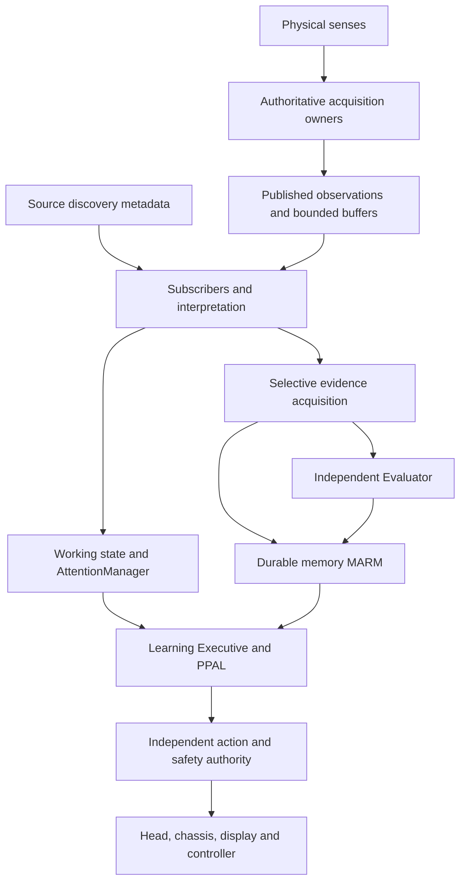

# Charlie Architecture

Charlie is one persistent, multi-body learning individual. The Pi 5 is the
principal cognitive/integration host; the ELEGOO car is a mobile body and a future
birdfeeder camera is a remote eye. Their observations and experience belong to
one identity, with shared memory and learning. An LLM, accelerator or physical
body can be replaced without replacing Charlie's history.

## Approved architecture

Physical senses publish independently of the current attention or presence of
subscribers. Passive, already-authorized sensing normally runs at a declared,
safe, bounded rate. Expensive, intrusive, privacy-sensitive or safety-gated
acquisition may require explicit activation. Suspended sources remain
 discoverable with their true status. An artificial idle subscriber is unnecessary.

One acquisition owner opens/configures/captures/recovers each physical source.
Consumers subscribe or query; they do not acquire camera hardware leases.
The registry is a directory and metadata authority, not a compulsory relay of
all raw bytes. Remote bodies can own their own bounded buffers. Hailo is shared
inference compute, not a raw sense. Receipt time is not exposure time.

**Perception** interprets source-identified observations into usable state.
**AttentionManager** selects current attention and display output. The
**Learning Executive** chooses interests and research priorities; **PPAL** learns
policy from experience. Neither evidence preservation nor an inference certifies
truth. The **Evaluator** assesses outcomes independently. **MARM** preserves
retrievable continuity; PPAL's local transition logs remain appropriate and
selected episodes may be promoted to durable memory. **Action** converts intent
through independent authorization, readiness and safety interlocks.

## Verified source reality and contract hierarchy

This is the canonical entry point, extended rather than replaced by a second
architecture. These contracts distinguish approved direction from implementation:

- [Resource ownership](architecture/RESOURCE_OWNERSHIP.md): source directory
  schema, acquisition owners, publication APIs, buffering and evidence boundaries.
- [Connectivity and deployment](architecture/CONNECTIVITY_AND_DEPLOYMENT.md):
  configured channels, firmware chain, readback, rollback and unknown live state.
- [Conformance](architecture/CONFORMANCE.md): traceable migration inventory,
  testable invariants and native acceptance gaps.
- [Audit report](architecture/AUDIT_REPORT.md): exact examined revisions,
  implemented correction, validation and safe handoff.

At the examined PR #11 revision, normal Pi/ELEGOO feeders and subscription-backed
compatibility APIs exist. This audit adds bounded local history and publication
ordering checks. Modality-wide discovery, network-wide clock mapping, remote
history and default decision-frame bookmarks remain incomplete. Published source
and host tests do not establish installed firmware, live sensor availability,
physical accuracy, safe navigation or native throughput.
