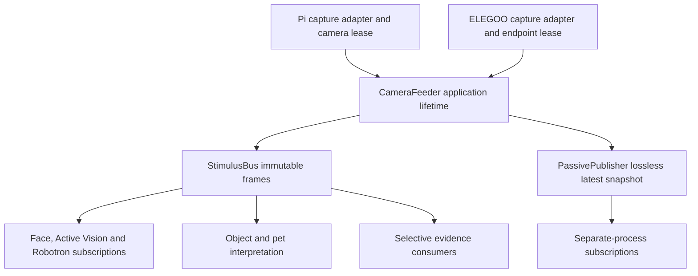

# Resource ownership and sensory publication

Contract beneath [Charlie Architecture](../CHARLIE_ARCHITECTURE.md).
Approved target requirements below are normative; inventory status is descriptive.
The audit branch starts at PR #11 `a19c90822687739f79f69587302006a1bd6364d4`.

## Ownership and access

`CameraFeeder` in `experiments/ppal/camera_session.py` extends the existing session
lifecycle; no parallel capture manager is introduced. Its feeder thread alone
opens through `vision.camera_source.capture_factory`, configures through a bounded
expiring queue and reconnects. Application startup/shutdown owns this lifetime.
Consumers own independent subscriptions, cadence and cancellation. No consumer
callback or inference runs synchronously in `StimulusBus.publish_frame`.

| Source/resource | Authoritative implementation | Access and verified status |
|---|---|---|
| `pi-primary`, IMX708 | `_PiCapture` → `_PiCameraDevice`, `CameraLease` | Feeder holds physical lease; local/ same-host passive subscription. Host fixtures; no new native qualification. |
| `elegoo-v4`, MJPEG | `_ElegooCapture` → `_ElegooCameraDevice`, `ElegooCameraLease` | Hostname-based cooperative transport exclusion; source exposure clock unknown. Local reader serves subscribers. |
| Hailo-8L | `hardware/hailo_session.py`, `vision/mobile_models.py` | Hash-bound HEF/session and cross-process lock; cooperative yield. No global fair scheduler or inference deduplication guarantee. |
| CPU temperature / memory / process limits | `learning/resources.py`, `hardware/system.py` | Direct local telemetry reads; guarded inference/learning checks. Not a registered general sensory stream. |
| Neck state / health | `hardware/neck_health.py`, RP2040 status | Derived control/health state, not a newly verified physical range sensor. |
| ELEGOO safety range/pose | `learning/mobile_safety.py` on latest PR #10 | Sensor/timing producer binding remains a native blocker per that PR; do not invent range from image/depth. Absent from PR #11 base. |
| IMU / future distance sensors | No established shared producer verified | Planned/unknown, not installed/tested claims. |
| Birdfeeder eye | No deployed producer verified | Planned remote publisher; no endpoint invented. |

Camera leases serialize physical admission, not attention. A pet **body command**
lease can correctly exclude conflicting movement. Older pet camera exclusions on
PR #10 must be reconciled against PR #11 subscriptions before stacking; the name
"exclusive" alone does not prove a defect. `CameraSession.borrow` remains a
compatibility lifetime wrapper; on PR #11 its Pi source is itself a subscription.

## Discovery contract: approved, not yet a general runtime registry

Every modality must advertise the following fields through a discoverable source
record; unavailable/unsupported fields must be explicit:

| Field group | Required metadata |
|---|---|
| Identity | stable `source_id`, producing body/device, modality, schema/data version |
| Owner / channel | authoritative acquisition owner, endpoint, publication transport |
| State | availability, health reason, effective rate, acquisition policy, last observation |
| Time | capture clock, receive clock, mapping/uncertainty, freshness limit |
| Retention | latest availability, recent-buffer count/bytes/time bounds, evictions |
| Authority | permissions, activation authority, privacy/safety gates, limitations |

`StimulusBus.frame_owners`, `CameraFrame.camera_identity`, feeder `camera_info`
and passive `latest.json` are partial existing discovery surfaces. They are not
a modality-wide registry or a distributed authority. A future extension should
adapt these owners and metadata, not create another physical-device manager.
Cross-host directory replication and permissions are unimplemented. Normal
Pi monotonic values must never be compared to another host's monotonic clock.

## Existing frame API and this audit's history correction

`claim_frames(source, owner)` enforces one local owner; physical leases provide
cooperative cross-process exclusion. `subscribe_frames(source, max_age=...)`
creates one replaceable pending slot per subscriber (64 subscribers total).
`publish_frame` validates matching source, immutable pixels and owner identity.
Producer dictionaries are snapshotted; each consumer receives private mutable
provenance and shares immutable pixels. `frame_fault` invalidates pending live
frames/history and reports an error. Release reports stopped; it never transfers
movement authority.

This audit adds `latest_frame` and `recent_frames` to the same bus, and seeds late
subscribers from retained healthy history. Defaults are **4 frames and 32 MiB per
source**, configurable within hard limits of 64 frames/256 MiB. These are host
implementation limits, not measured Pi retention targets. Caps apply to retained
history, not the existing independently bounded pending slots. An oversized frame
is delivered live but not retained, incrementing `frame_evictions`. Count/byte
truncation and generation/fault invalidation also increment that counter.
No full-rate video or disk persistence is introduced. Query freshness is bounded
to at most five seconds; expired/future receipt times return no query result.
A late subscription to a fault raises; it does not resurrect an older good frame.

Within one generation, duplicate/regressing sequences and regressing receive
times are rejected, including after byte-budget eviction. A new generation clears
recent history. Cross-device ordering is not asserted. Fault recovery requires
fresh source frames, and faults never grant hardware authorization.

`CameraFrame` / `MobileFrame` carry exact source/frame ID, sequence, local receipt,
BGR geometry, authentic/fixture distinction, source exposure time/uncertainty when
known, stream generation and camera metadata. Pi capture uses same-request pixels
and metadata, with request time explicitly separate from exposure. ELEGOO MJPEG
has no established exposure timestamp. Quality/calibration remain unknown where
not measured. Passive cross-process publication validates source, boot, freshness
and decoded pixel hash; it is latest-only and same-host, not a remote clock service.

## Inference, memory and evidence

`MobilePerception`, `HailoObjects` and Object Recognition reuse one model adapter
for both cameras. Observation metadata binds original frame IDs, model manifest,
HEF hash and code revision; preprocessing/postprocessing identity must be made
explicit before claiming full model reproducibility. Hailo lock contention is
unavailability, not permission to open a second camera or substitute stale data.
Thermal guards can suspend interpretation independently of capture; capture does
not yet have its own measured thermal-rate policy.

Keep three lifetimes distinct: latest/current state, bounded RAM sensory history,
and selective durable evidence. Existing `FrameArtifactStore` preserves bounded
content-addressed PNG pixels; `EventRetention` selects mobile pet events.
`EvidenceJournal` records predictions, faults and evaluation. Object Recognition
currently journals observations without a default exact-pixel retention hook.
A new history query is **not** itself a durable bookmark. Future bookmark support
must select exact source/generation/frame ID and record hash, capture/receipt and
clock uncertainty, model/code revision, selection reason and retention/error state.
Expired/dropped requests must remain explicit. Representative samples, scene
changes and bounded pre/post context must be independently configurable. Preserve
competing interpretations and original journals; a saved prediction is not truth.

Evidence acquisition owns preservation; the Executive chooses questions; the
Evaluator assesses outcomes. Do not make saving evidence conditional on agreeing
with a prediction. Default evidence bookmarking and representative sampling remain
explicit remediation work, rather than claimed behavior of this history patch.
