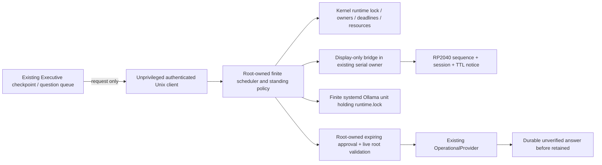

# Native scheduler and visible notice: trust and ownership

Mission #37 d890d598, on #36 0567147d (local equivalent 1d14a3e, tree
56d71274708e0a85d91d71ac31058d4f0fb93883). Approved runtime remains d3dca905.
The approved firmware has OBJECT_LABEL but does not support MEDITATION. No
capability acknowledgement is fabricated, no generic MESSAGE fallback is used,
and no unattended operation can be admitted on that firmware.

The Executive cannot write scheduler code, policy, receipts, ledger, socket or
standing approvals. Root deployment is required later, never performed here.
Manual owner-only per-window Admission remains intact. New standing admission
must authenticate a live root broker and root-owned immutable policy/receipt;
same-user JSON cannot create standing authority. No LLM output reaches an issuer.

| Priority | Rendering / action |
|---|---|
| STOP, watchdog/link loss, ERROR | cancel notice, never renew old slot; safety rendering wins |
| Calibration capability | cancel busy lease; calibration notice wins |
| Valid reserved meditation | smooth 3x5 pixel scroll MEDITATING PLEASE WAIT, no flickering pages |
| Normal messages, feedback, labels | resume when notice clears/expires; normal label TTL still applies |

Requesting is not visible. Reservation must succeed before PREPARING ack. Begin
client work only after a matching session/slot/sequence rendered acknowledgement.
Refresh TTL (2s native default) without resetting scroll, bounded by reserved end.
Never display a countdown we cannot guarantee. CLEAR must be acknowledged; lost
connection/host death falls back to device TTL and NO_BRAIN. No new serial owner:
the bridge receives an already-owned RP2040Controller; construction/open/reset is
not part of that bridge. Firmware changes are staged source only, never flashed.

State machine: requesting -> reserved -> notice-acknowledged -> meditating ->
optional preparing/consulting -> answer durable -> unload -> notice cleared ->
available. Any safety duty, policy revocation, missing display ack, unknown owner,
client death or resource failure cancels. Service cleanup/observed cgroup empty
precedes release. Unknown inference completion remains latched and never retries.
A kernel-bounded model process itself holds runtime.lock so issuer death cannot
prematurely release exclusion while inference survives. Normal interactions may
be durably deferred; urgent requests revoke immediately and are never queued.

Native qualification must establish the complete owner inventory, real serial
bridge isolation, rendered pixels, reboot/STOP latency, effective cgroup cutoff,
service identity, source pin and privilege separation. Software tests are not
proof that these prerequisites are installed. Policy is disabled by default.
