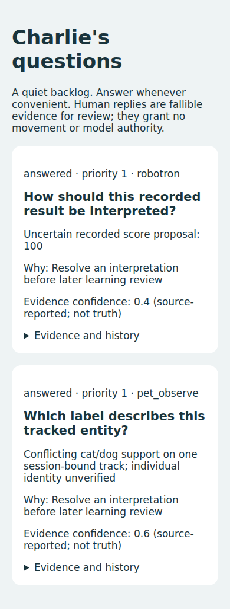

# Acceptance receipt — 2026-10-28

**Draft / partial software acceptance; no live or native release.**
Branch: `feature/asynchronous-human-questions`, PR #14. Base `bcf8082`.

Published implementation increments:

- `50665a5556e0b64fe8d15ab4f225e1feb7554633`: Executive detection/API,
  journal queue/answer lifecycle, generic authenticated web UI and HTTP tests.
  Local/published tree `07c17193e4e6c654bcfe95f67eeab15f002454ae`.
- `6b2317c1f9889da57aebe0450333c398099c146d`: atomic requester review
  intake, desktop/mobile-emulation browser CI, runbook and real tracker adapter
  compatibility test. Tree `e6fb9b33876f32c2fb72fc7b52d94f2c702c3758`.
- `eb0128d91986fb7e1ce35a358b13ddc53d0cfe08`: transactional lifecycle
  changes, concurrent-answer and interrupted-intake rollback checks.
  Tree `56fd4dbf20d1404645fe6cb7e7879b99fc0d7c7b`.

## Acceptance matrix

| Mission item | Result | Evidence / limitation |
|---|---|---|
| 1. Executive uncertainty yields deduplicated question | PASS API / PENDING normal live trigger | Actual LearningExecutive reads committed evidence; deterministic adapters tested. No normal producer hook enabled. |
| 2. Unanswered restart persistence | PASS software | Reopened SQLite journal retains question and source links; HTTP process independent from producer. |
| 3. Functional asynchronous browser UI | PASS Chromium / PENDING physical iPhone | Desktop 1280x900 and mobile emulation 390x844; real HTTP answers and reload; screenshots retained by CI. |
| 4. Validated immutable attributed answer | PASS software | Existing append-only EvidenceJournal; exact replay, contradiction, HTML, forged ID and CSRF checks. |
| 5. Original learning consumer receives evidence | PASS callable review intake / PENDING live attachment | Atomic requester-owned human_answer_review and acknowledgment; no models or grants changed. |
| 6. Pet and Robotron end-to-end | PASS deterministic contracts / PENDING live | Both use same API/renderer and review evidence; no cat or game observed. Real PR #13 PetTracker + MobileEvidenceAdapter contract also exercised in isolated checkout. |
| 7. Regression and security | See receipts below | No hardware regression qualification inferred from host tests. |
| 8. Native/hardware limits stated | PASS documentation / native PENDING | Pi service, actual phone, approved tunnel, live Executive trigger and source-approved pixel preview not witnessed. |

## Independent receipts

- First full CI: [run 40755205651](https://github.com/mrgarmise/charlie/actions/runs/40755205651),
  exact commit `50665a5`: **1,274 passed, 21 skipped**, one warning, 334.88s.
- Browser/security CI: [run 40755715206](https://github.com/mrgarmise/charlie/actions/runs/40755715206),
  exact commit `6b2317c`: **27 passed, 1 skipped**, 3.65s. Artifact
  `human-question-validation`, ID 12845524214, ZIP SHA256
  `79d4de84d374b9e9f892a2a608d9d51fe75ffe1d434ade6279506f3988f59dd8`.
  Desktop and mobile screenshots plus JUnit were downloaded with digest verified;
  mobile layout visually inspected. Screenshots show **synthetic** answered
  pet/Robotron examples, never personal camera footage.
- Latest browser/security CI: [run 40756086769](https://github.com/mrgarmise/charlie/actions/runs/40756086769),
  exact runtime `eb0128d`: **29 passed, 1 skipped**, 5.07s. The one skip is
  the unmerged PR #13 tracker adapter contract, tested separately below.
- Local final focused command: `python -m pytest tests/test_human_interaction.py
  tests/test_human_questions_http.py -q`: **27 passed, 1 skipped**, 1.91s.
- Isolated PR #13 `08ae83f` plus additive patch: focused/mobile/pet/shared
  camera/Executive regression selection **206 passed**, 44.66s. Later final
  question-contract selection **28 passed**, 1.79s, including the actual
  PetTracker/MobileEvidenceAdapter synthetic observation sequence.
- Isolated PR #13 `python tools/check_unified_contracts.py`: **91 passed**, 3.60s.
  The original integration worktree/ref is unchanged; this is an uncommitted
  disposable compatibility checkout, not a merge or deployment.

Local broad and final independent broad CI receipts are recorded in the final
validation addendum. Their historical output is retained even if failures are
later reproduced or corrected. Browser download in this workspace failed
(truncated upstream ZIP); independent CI actually installed and ran Chromium.
No local browser-execution claim is made.

## What is real, what is bounded, what remains

This is working Python, SQLite and HTML, not a mockup. The existing Executive
performs deterministic detection on supplied committed evidence and applies
bounded policy before enqueueing. Fixed templates phrase the structured need.
There is no LLM, generalized curiosity, live cat recognition improvement,
autonomous questioning loop or demonstrated game performance improvement.
The two examples are explicitly deterministic synthetic observations.

Policy inputs are declared decision consequence, priority and alternatives.
The transparent value heuristic is uncertainty × consequence >= .25. The policy
also checks evidence age, duplicate session subject, cooldown, rolling budget,
queue size and available alternatives. Waiting preserves uncertainty and lets
other work proceed. Human observations remain fallible, source-attributed and
pending independent review. An answer is never motor authorization or model
training. Existing ScoreObserver independent digit review is not bypassed.

Security: loopback-only listener, secret authentication, exact Host, CSRF and
cross-site rejection, strict bounded forms, escaped text, no script/file/camera
routes, no request logging of secrets/answers. Source references must already
exist; the HTTP layer cannot create evidence or information needs. No image
serving is claimed until privacy/authorization contracts are integrated.

PENDING code-level work is described in README: PR #13's
`MobileEvidenceAdapter.opportunities(observation_id)` must opt into the existing
Executive call with actual decision context; Robotron source journals need a
reviewed consolidation adapter to the application notebook with immutable
lineage and source freshness preserved. Normal requester adapters must attach
review intake. Keep this PR draft until those paths are integrated and witnessed.

No GPIO assignment, serial protocol, firmware, controller, motor gate, sensor
acquisition owner, policy, original log or qualification record changed.
No Pi connection, camera activation, motor command, flash, deployment, merge or
rebase occurred. Physical Pi/phone/tunnel tests remain operator work; the no-motion
checklist is in README. Existing PRs #3 and #5–#13 remain untouched.

## Local broad validation addendum

Host broad run of the first implementation increment: **1,269 passed, 21 skipped,
5 failed**, one warning, 486.50s. Its five failures reproduced on unchanged
`master bcf8082` in a separate checkout: **47 passed, 5 failed**, 20.08s.
All five baseline failures report `ObservationFailure: evidence writer saturated
or failed; controls must pause; emergency item retained`. No production writer
or safety behavior was changed to make tests pass. This isolates the failures
from the new question feature in this host environment; it does not establish
the writer's root cause or dismiss the original failures. Full independent CI
on `50665a5` passed all 1,274 eligible tests. Final runtime CI is tracked below.

Reproduced failing nodes:

- `test_marathon_camera_session.py::test_real_player_starts_two_simulated_playable_games_on_one_camera[False]`
- Same test `[True]`.
- `test_native_terminal_forensics.py::test_terminal_confirmation_inside_batch_wins_over_processing_deadline`
- `test_native_terminal_forensics.py::test_terminal_diagnostics_are_durable_and_bound_to_original_observation`
- `test_prompt_terminal_restart.py::test_two_real_player_episodes_reject_intervening_demo_with_shared_camera`

Host: Python 3.12.14, NumPy 2.3.5, OpenCV 5.0.0. Original logs are in
`validation/host-broad.txt` and `validation/baseline-boundaries.txt`. The initial
missing-dependency collection failure (34 errors, 1 skipped) is also retained;
after installing declared dependencies, the host broad run above completed.
Final focused source includes two later lifecycle/concurrency tests and passes
27 tests with the one explicit unmerged tracker skip; isolated PR #13 passes all
28. These later changes are new opt-in code and tests only.

The screenshot comes from independently exercised CI `6b2317c`; UI bytes are
unchanged in `eb0128d`. Desktop and mobile original files remain in the linked CI
artifact. This is Chromium emulation, not a physical iPhone Safari receipt.

Independent broad CI on `6b2317c`, run 40755715064: **1,275 passed, 24 skipped,
1 failed**, one warning, 378.16s. The failure is the existing simulated
camera-failure marathon test `[True]`: evidence writer saturation occurred
before camera recovery, so `cal_recovery` was None. This is one of the five
failure nodes reproduced locally on unchanged master. Its exact CI symptom is
retained in `validation/ci-full-6b2317c.txt`; no rerun hides the failed run and
no writer queue/safety limit was relaxed. The three additional skips are the
PR #13 contract and two opt-in browser cases (browser cases pass dedicated CI).
Broad regression acceptance is PENDING due this retained writer issue even
though the first full independent run passed. Writer root-cause diagnosis is
outside this bounded interface implementation and remains unresolved.

Latest full CI for runtime `eb0128d`:
[run 40756086817](https://github.com/mrgarmise/charlie/actions/runs/40756086817)
was still running at report publication. It is **PENDING**, not counted as a pass.
The evidence-only publication that contains this report changes no runtime or
test source after the validated `eb0128d` increment; source hashes are retained.

Final inventory recheck: PRs #3 and #5–#13 retain their originally inspected head
SHAs, including PR #13 `08ae83f`, #12 `ae09f52`, #10 `9c1319d`, #8 `b4f2588`
and #7 `83112b4`. All remain draft. No merge, rebase or upstream write occurred.
