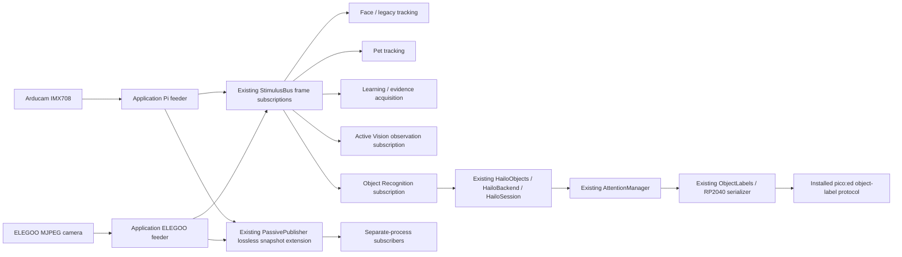

# Normal Object Recognition and authoritative camera feeders

Object Recognition is a normal application mode. It uses the installed, hash-bound Hailo-8L YOLO model and the existing Attention Manager/object-label protocol. It does not construct Deck, a mobile base, a navigation planner or an execution backend. Firmware and motion code are unchanged.

## Application ownership and shared publication

Object Recognition selects a frame subscription and **does not own a camera**. The application creates one `CameraFeeder` per physical camera using the existing `CameraSession` lifetime boundary. That feeder alone opens, configures, captures, recovers and closes its underlying device. Pi admission still uses the existing `CameraLease`; ELEGOO admission uses the transport's endpoint lease. Missing ownership admission fails closed.



Both normal-app feeders capture continuously, whether a particular capability is active or not. Every local subscriber has one replaceable pending frame; producer delivery never invokes consumer code, waits for inference, or performs consumer I/O. Owned image snapshots have immutable backing bytes. Subscriber provenance dictionaries are isolated. Slow consumers drop intermediate frames instead of retaining a backlog or blocking capture. There are at most 64 local subscriptions. Source identity, sequence, generation, receipt time, capture-request time and available same-request Pi exposure metadata accompany the original pixels. Receipt time never becomes a fabricated exposure timestamp.

Selecting `pi` or `elegoo` closes and replaces only that consumer's subscription. It neither restarts nor closes either feeder. Face, pet, learning/evidence and other authorized subscribers continue receiving the same camera's frames. A source fault replaces pending frames with a fault; recovery belongs to the feeder and receives a new generation. Object Recognition discards pending labels and tracking associations on faults, source switches or generation changes, then requires fresh confirmation.

The existing passive publisher provides separate-process distribution too. Its existing worker, demand file and atomic `latest.json` publication now optionally carry a lossless full-resolution PNG plus original frame metadata/hash and boot identity, alongside the existing browser JPEG. Subscribers verify source, boot, freshness and decoded-pixel hash. They never open a physical camera, start an idle capture, or promote the older thumbnail-only preview format into qualified source pixels. Publication retains the existing one-element pending queue and bounded worker cadence. Demand controls optional encoding, not capture. Closing a remote subscriber leaves the feeder and other consumers running.

## All capability camera paths

`vision.camera.Camera` and `hardware.elegoo_camera.ElegooCamera` are now compatibility **subscribers**, including callers in face tracking, Eyes/Active Vision, PPAL acquisition, saved-evidence capture and preview. `vision.tracker.Tracker` subscribes instead of calling OpenCV VideoCapture. Mobile observation takes an application frame bus or subscribes to the existing separate-process publication. Its standalone capability command never starts a feeder. Neither a subscriber constructor nor a camera selection can start a physical transport. Without an available feeder, compatibility consumers wait for a bounded published frame or report unavailable; there is no direct-camera fallback.

Raw device implementations are private (`_PiCameraDevice`, `_ElegooCameraDevice`) and constructed only by application feeder adapters. The architecture test audits production constructor call sites. The existing application root starts/stops the feeders; individual capabilities only release subscriptions. The explicitly authorized Active Vision entrypoint starts its application feeder only after its existing motion/electrical gates pass. Its observations are subscriptions, and its existing actual camera-role, firmware, calibration and scoped-motion checks remain in force. Releasing an optimizer subscription is recorded separately from the feeder's application lifetime.

Focus/exposure configuration requests use a bounded queue to the existing feeder and must match its actual physical lease role. Only its capture thread calls the driver. Requests expire and are cancelled when unacknowledged. Remote subscribers cannot configure hardware. No subscriber can create a role merely by selecting a feed, and Object Recognition exposes no configuration or motion controls.

## Normal mode and provenance

For later authorized native operation (not executed during implementation):

```sh
/home/five/Projects/charlie/.venv/bin/python main.py --hardware --object-recognition --camera-source pi
```

Object mode defaults to the existing pico:ed protocol; `--object-label-display off|dry-run|rp2040` remains explicit and can override that mode default. `--object-model-manifest` defaults to `~/charlie-mobile-models/mobile-models.json`. The read-only inspected installed manifest names `/home/five/charlie-mobile-models/yolov8n-hailo8l.hef`, SHA256 `90e2cdad2875f23fb436ecdba88b4789de3bd8112cdf6b34beb1c8aa9fd7eed1`, 640 input and the complete 80-class order. The installed bytes match that hash. This is artifact identity, not a new native inference/accuracy qualification.

Use `--camera-source elegoo` for the other initial subscription. In the normal console, `1` selects Pi, `2` selects ELEGOO and `q` exits the application (line-buffered terminals may require Enter). These controls never emit scan, track, calibration or navigation events. Optional `--object-frames` / `--object-seconds` bound an operator session. Hardware mode remains explicit; replay cannot turn it on.

One existing Hailo object adapter serves both source selections, with all exported object classes enabled. Labels reuse that same inference packet; no second model pass is performed for display. Existing accelerator exclusion, freshness/resource checks and firmware capability negotiation remain enforced. All observations are unqualified class hypotheses, not individual identity or measured detector accuracy. The normal Executive worker and interruption supervision remain active. Source-identified observations enter the existing mobile-evidence journal and normal learning intake; no alternative learner, forced agenda, motion grant or manufactured learning conclusion is introduced.

The existing primary tracking byte/coordinate contract is preserved; object inference receives canonical BGR pixels. A stalled tracking subscription emits vision loss rather than retaining a stale target. The default application mode, offline learning, replay, calibration/firmware tests and existing label hysteresis/TTL behavior are covered by regressions.

## Source files and mandatory acceptance tests

| Responsibility | Relevant implementation |
|---|---|
| Application lifetime and normal mode | `main.py`, `learning/object_runtime.py` |
| Existing owner extended into continuous feeder | `experiments/ppal/camera_session.py` (`CameraFeeder`) |
| Existing bus extended into latest-only subscriptions | `stimulus/bus.py` |
| Existing passive publication / separate-process subscriptions | `experiments/ppal/eyes/passive.py` |
| Authoritative capture adapters and consumer subscription selector | `vision/camera_source.py` |
| Legacy camera APIs, now subscribers | `vision/camera.py`, `hardware/elegoo_camera.py`, `vision/tracker.py` |
| One inference packet through existing attention | `vision/object_recognition.py`, `vision/object_observation.py`, `attention/manager.py` |
| Existing mobile/learning intake | `learning/mobile_runtime.py`, `behaviors/mobile_observe.py` |
| Existing physical admission / Active Vision gates | `experiments/ppal/eyes/camera_lease.py`, `experiments/ppal/eyes/run_active_vision.py` |

| Criterion | Executable demonstration |
|---|---|
| One capture owner; many subscribers | `tests/test_camera_sources.py::test_one_authoritative_capture_serves_many_consumers_until_application_closes` |
| Concurrent consumers, switches, stalled consumer and uninterrupted capture | `tests/test_camera_sources.py::test_concurrent_capabilities_switch_without_capture_restart_or_slow_consumer_backpressure` |
| Source switching leaves face/learning delivery intact | `tests/test_camera_sources.py::test_subscription_switch_does_not_control_feeders_or_other_subscribers` |
| One-element queues, freshness, fault invalidation and owner-only publication | `tests/test_camera_sources.py::test_bounded_nonblocking_freshness_fault_and_publisher_authority` |
| Only authoritative constructors open devices | `tests/test_camera_sources.py::test_only_authoritative_driver_implementations_can_open_physical_cameras` |
| Configuration executes only on feeder thread with existing role | `tests/test_camera_sources.py::test_configuration_executes_only_on_existing_feeder_thread_and_role` |
| Separate processes reuse lossless source frames | `tests/test_published_frame_subscription.py::test_independent_processes_subscribe_without_device_constructors` |
| Legacy Pi/ELEGOO/tracker use the same publication | `tests/test_object_recognition.py::test_legacy_pi_elegoo_and_tracker_use_same_publication_without_native_imports` |
| Actual Object Recognition subscription switch clears/reconfirms labels | `tests/test_object_recognition.py::test_switch_subscription_preserves_other_consumers_and_forces_reconfirmation` |
| Real perception/attention/serializer/learning integration, all classes | `tests/test_object_recognition.py::test_all_classes_through_attention_serializer_and_learning_with_no_motion` |
| Normal mode supervises existing learning without constructing Deck | `tests/test_object_recognition.py::test_normal_main_owns_application_feeders_and_supervises_existing_learning` |
| Actual normal runtime, manifest, serializer and evidence journal | `tests/test_object_recognition.py::test_normal_recognition_runtime_uses_existing_manifest_and_immutable_frames_only` |

All test pixels, camera transports, UART replies and firmware board dependencies are explicit fixtures. `tests/conftest.py` rejects unmocked physical capture, serial and nonlocal HTTP I/O while allowing native loopback fixtures. The first native full run was stopped after 22 passes/one skip to complete those test guards; no camera test had run. Historical failed/interrupted receipts remain preserved. The native device-free full suite passed 1,365 tests with 24 skips; the final focused selection passed 97 tests, including the final mobile CLI subscription and empty-poll accounting refinements. The full suite preceded those final refinements. See [the continuation report](CONTINUATION.md) and its original receipts for exact scope. No physical camera activation, firmware flash, servo/motor movement, navigation or learned-policy activation is claimed.
