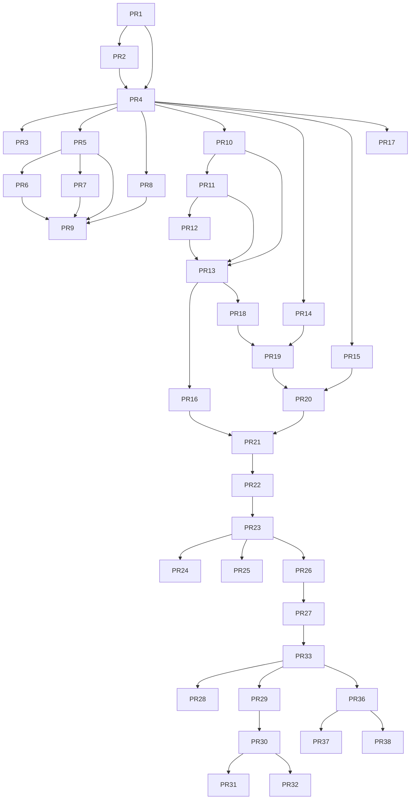

# Dependency graph and conflicts

#13 supersedes older #10/#11 overlap. #19/#20/#21 reconcile #14/#15/#16. #25 is a sibling, selectively included in the approved font/source chain, not implied by #26 ancestry. #35/#37 are instructions only. #27/#33 are protected manual LLM; #36/#38 stay dormant. #28/#29 share #33 ancestry; #31 and #32 are siblings on #30: keep newer #31 control corrections, add only #32 audit. #9 overlaps #5/#6/#7/#8 and predates shared camera publication; never overwrite its successor source owner. Native enablement and source dependency are separate edges.

Historical stock STOP is HANDLED — DONE / OK per refreshed #31 cab7bab. Older #32 text does not reopen it. Candidate transport/firmware timing is a separate new-version qualification.
