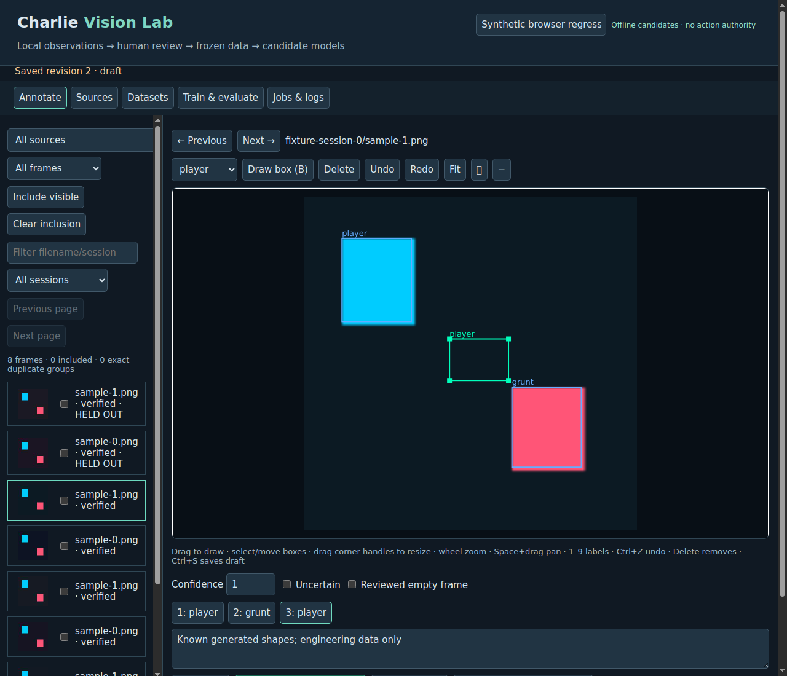

# Engineering verification — Vision Lab 0.1

Source base: master `bcf8082f6319c63c4bd6bcceeab5faea37241654`, independently
rechecked against GitHub before publication. Dedicated branch:
`feature/charlie-vision-lab`. Existing master, historical branches, the original
Executive notebook and observations are unchanged. A pre-existing modified
fixture in the separate `charlie` worktree was preserved and excluded.

The governing charter/acceptance standard and earlier ALA mission requirements
were consulted before implementation. Existing score-review HTML/history was
inspected, including `c709ddc`, `966988b`, `49ad061`, `d1fc960`, `1c13cc7`.
Reusable patterns: acknowledged durable saves, reviewer identity, image-decode
readiness, stale-image generation guards and retained review history. No prior
user feedback or October 10 label recovery is invented here. This is a distinct
bounding-box workbench, not a replacement for verified score-review history.

## Executed checks

Host: isolated Linux x86_64 / kernel 6.18.44 / glibc 2.39, Python 3.12.14,
CPU-only Torch 2.14.1+cpu, torchvision 0.29.1+cpu, Ultralytics 8.3.203,
ONNX 1.23.2, ONNX Runtime 1.31.0, Pillow 12.3.0, Paramiko 5.0.0,
pytest 9.1.1. Virtual environment included primary-runtime system packages;
this is **not** a native Mint or Pi installation. `pip check`: no broken
requirements. Compilation/import checks and staged diff whitespace checks pass.

| Executed validation | Result |
|---|---|
| `VISION_LAB_ML_TESTS=1 python -m pytest tests/vision_lab -q` | **21 passed**, 27.72s, zero skipped |
| Default `python -m pytest tests/vision_lab -q` | **19 passed, 2 skipped**, 2.64s; optional real ML tests intentionally opt-in |
| Existing `test_ppal_eyes`, `test_score_tracker`, `test_score_review_frontend`, `test_ppal_readiness`, `test_thermal_recovery` | **57 passed**, 1.09s; one existing JUnit `record_property` format warning |
| Real rendered Qt WebEngine/Chromium browser fixture | **PASS**: 8 frames; draw/move/resize; undo/redo; zoom/fit; acknowledged draft save; two preserved revisions; Sources/Annotate navigation |
| `vision_lab.demo --train --export` | **PASS** actual optimizer/checkpoint, held-out measurement and checked ONNX bundle |

Browser test used PySide6 6.12.0 / Qt WebEngine 6.12.0.140, software rendering,
headless offscreen Qt. The container's root-owned **isolated test browser** needed
its own sandbox-disable setting; the app/user browser configuration was not
changed. Restricted container DBus/netlink/udev/OpenGL warnings were recorded;
the actual interface loaded, handlers executed and saved history was verified
from SQLite. Screenshot below is generated shape data, not Robotron evidence.

Tests cover multi-format/corrupt/missing/incremental discovery, untouched originals,
scoped local/SFTP reads, metadata-only remote inventory and selective retrieval,
symlink/path/archive escape controls, notebook guard, annotation integrity and
stale revisions, explicit proposal acceptance/negative labels, duplicate/session
partition isolation, frozen versions/export integrity, detection metrics,
HTTP Host/origin/session/CSRF boundaries, job bounds/cancellation/restart,
conservative unknown-PID handling, competing-worker lock refusal, model weight
provenance, frozen baseline comparison, exposed-test training rejection, real
checkpoint resume, actual assisted-inference jobs with no ground-truth writes, ONNX numerical consistency, and Charlie's observation-only
pipeline returning no WorldState. SFTP is tested with a deterministic protocol
double; actual `charlie.local` connectivity is unavailable.

## Actual synthetic training observations

See [retained run report](synthetic-run.json). Eight generated 96×96 images,
four configured fixture sessions, two classes; frozen partitions: four training,
two validation, two test. One epoch at 64px, CPU, batch 2, two threads:

- Model ID: `59eb92ef6794498f835d3932ea0867d2`; **2 actual optimizer steps**.
- Initial state hash: `d9e06f44aa450fe9b12eff8986d84fa914ebdcda2be00e8d63da8ce94b355847`.
- Trained state hash: `2f2837e25ce1bfeb3d59582c76f32b134499d3953d50f76e0726c655da5011d7`.
- Checkpoint SHA256: `c19b1c7e171d8881b4c1bf04414fe25f5deab52e6686f3c684daeae733f2cf97`.
- Held-out: 2 frames, 4 missed objects, 0 predictions, 0 false positives;
  recall/AP50 = 0; precision **undefined**, not claimed as perfect.
- Mean local end-to-end inference call: 19.24ms, not Pi/Hailo performance.
- ONNX SHA256: `56935eb8f43df4faf68c174678c92578c34393a6437a88ceb557efa9b2635aa3`;
  checked opset 11, `[1,3,64,64]` input / `[1,6,84]` output; Torch/ORT zero-tensor
  maximum absolute error `6.103515625e-05`.

A separate real ML regression trains a one-epoch baseline and a two-epoch candidate,
freezes the baseline hash before the candidate, evaluates both on the same two
held-out fixture frames, verifies retained original model/checkpoint bytes and
rejects later training after test exposure. Another test cancels after an actual
completed epoch and resumes the retained optimizer/epoch into a **new** job output
directory while the source checkpoint hash stays unchanged. Neither comparison
shows authentic recognition improvement. The branch includes a fixture-only GitHub workflow (CPU ML checks opt-in by manual
dispatch); no release tagging or hardware deployment occurs. Local results above
are independently executed; remote CI results must be inspected separately.

Model binaries remain local test
artifacts; no candidate is activated or packaged as a Robotron-trained release.

## Defects discovered and repaired during verification

- Duplicate pixels in different source formats could share a cache without a
  bound file digest; hydration now verifies decoded pixels and binds/verifies
  cache integrity instead of trusting an existing filename.
- Ultralytics creates label caches in its dataset input directory. Training now
  uses an isolated copy of **train/val only**; immutable exports and test pixels
  are not exposed to the optimizer or modified by training caches.
- Torch's changing ONNX exporter default required a missing optional dependency.
  The explicit fixed-shape legacy adapter is checked against Torch/ONNX Runtime.
- Ultralytics resume retained checkpoint `save_dir` despite a new project path.
  Resume now rewrites the isolated checkpoint's data/project/name/**save_dir**,
  preserving the original epoch checkpoint; the causal preservation test passes.
- Worker launch bookkeeping assumed the parent's `/proc/<child PID>` namespace.
  The worker now records its own process generation, and recovery requires
  owner/start-generation/command/process-group verification. Unknown identity is
  never signalled; a live worker lock prevents a competing scheduler.
- SQLite connections now close explicitly. Invalid annotation types and an
  unrestricted remote `/` root are rejected. Polling/suggestion priority never
  creates verified ground truth or uses unaccepted labels as class balance.

## Implementation versus outstanding evidence

| Capability | State |
|---|---|
| Local editor, datasets, real CPU jobs, restart, metrics, suggestions, ONNX | Implemented and fixture-tested |
| Read-only SFTP adapter | Implemented, protocol/control tests pass; native SSH unverified |
| Charlie detector compatibility | Executed offline; no WorldState/controllers/actions |
| Mint install/hardware and browser usability with real archives | Operator verification needed |
| Authentic Robotron object labels / independent held-out sessions | Not available for this mission |
| GPU acceleration | Configurable CUDA path; not executed |
| Exhaustive video/structured metadata schema import | Deferred; bounded local samples/detection warnings implemented |
| Near-duplicate independence | Session grouping plus exact-pixel checks; operator audit needed |
| Hailo-8L HEF, quantization accuracy and hardware latency | Not demonstrated; no compiler/device available |
| Pi software deployment, live camera/gameplay, servo movement, PPAL activation | Not performed or authorized |
| ALA E1/P1/I1 and full ALA-2 | Remain independent and open |

Next operator validation: install in a clean Mint venv; confirm `pip check` and
Preflight; register one scoped read-only archive; verify selected-source hashes
and group independence; annotate authentic observations; freeze a fresh test
partition; train candidates using train/val only; finalize selection before a
single held-out comparison; retain manifests/logs/model hashes; then prepare
Hailo-8L compilation in a supported versioned toolchain. No automatic deployment
or model activation is supplied.
