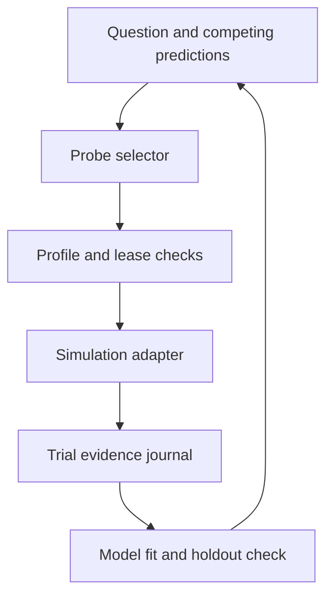

# Architecture

Charlie owns the versioned research source. Dog loads the same source from a pinned sibling checkout. Neither operational entry point imports the research package.

The journal records the plan before executing a trial and appends its observations after validation. An interrupted plan stops the resumed session. The current inquiry implementation records one evaluation of competing predictions. The full restartable question lifecycle remains open.
